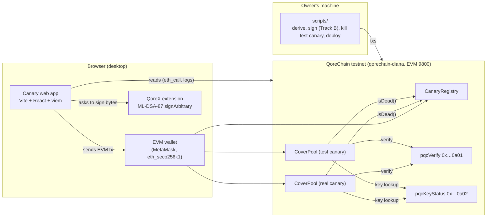
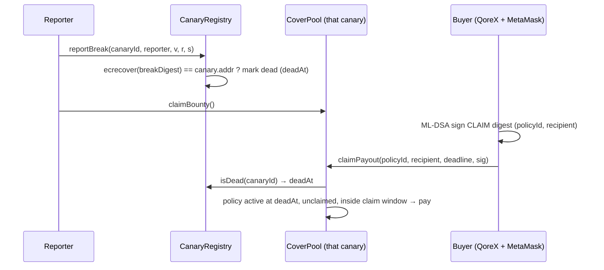

# 02 — Architecture

## Components



| Component | Responsibility |
|---|---|
| **CanaryRegistry** | Stores canaries (address, label, derivation phrase, test flag). Accepts the break proof (`ecrecover` signature), records death time and reporter. Holds nothing of value. |
| **CoverPool** (×2) | LP shares, cover policies, premiums, withdrawal cooldown, payouts after death, bounty. One instance per canary. |
| **PQAuth** (library) | Builds the action digest, looks up the owner's registered ML-DSA-87 key via `pqcKeyStatus`, checks the signature via `pqcVerify`, consumes the nonce. |
| **Web app** | Status, LP, cover, claims, admin. Reads chain state; sends EVM txs through the EVM wallet; gets ML-DSA signatures from QoreX (Track A) or shows the command for Track B. |
| **scripts/** | Canary derivation and verification, test-canary key generation and kill, Track B signing, deployment, demo seeding. |

## Accounts and keys

QoreChain EVM transactions are admitted only from an account that has **(1)** a registered ML-DSA-87 key and **(2)** an open EVM window. EVM accounts must be **`eth_secp256k1`, coin type 60**. The `0x…` and `qor1…` forms are the same account.

| Account | Created with | Holds | Needs |
|---|---|---|---|
| `deployer` (also admin) | `qorechaind keys add deployer --key-type eth_secp256k1 --coin-type 60` | Deploy rights, admin role | Registered ML-DSA key with proof of possession; unscoped window for deploys; scoped window afterwards |
| `lp1` | same | LP shares | Registered key; scoped window |
| `buyer1` | same | Policies | Registered key; scoped window |
| `reporter` | same | Receives the bounty | Scoped window to the registry |
| Test canary key | `scripts/gen-test-canary.ts` (plain secp256k1 keypair) | Nothing; only signs the break proof | Never needs QOR or a window — it signs off-chain; the `reporter` submits |

Faucet: 100 QOR per claim, once per 24 h per account. One person may use only their own registered accounts; do **not** create extra faucet sign-ins. Move QOR between your own accounts instead. Budget in `05_QORECHAIN_INTEGRATION.md`.

## The signing model (the heart of the dApp)

### Two signatures, two jobs

| Signature | Algorithm | Who signs | What it proves |
|---|---|---|---|
| EVM transaction signature | ECDSA (eth_secp256k1), plus the chain's EVM window gate | Whoever submits the tx (`msg.sender`) | Pays gas; nothing about authority |
| **Action authorisation** | **ML-DSA-87**, checked by `pqcVerify` | The **owner** of the shares or policy | That the owner approved this exact action |

Money-moving functions take an explicit `owner` and an ML-DSA signature, and **never trust `msg.sender` for authority**. The contract loads the owner's registered key with `pqcKeyStatus(owner)` and requires `registered && possessionProven && algorithmId == 1`.

This means:
- After Q-Day, a stolen or broken ECDSA key lets an attacker send transactions, but not authorise withdrawals or claims.
- The owner and the submitter can differ (for example QoreX holds the owner's PQ key, MetaMask submits).

### The action digest

Every authorised action is a 32-byte digest:

```solidity
digest = keccak256(abi.encode(
    DOMAIN_TAG,          // bytes32: keccak256("Canary.v1")
    block.chainid,       // 9800 on testnet
    address(this),       // the pool (or registry) contract
    ACTION,              // bytes32: keccak256("REQUEST_WITHDRAW") etc.
    owner,               // address whose ML-DSA key must sign
    nonce,               // uint256: per-owner, must equal nonces[owner]
    deadline,            // uint256: unix seconds; reject if block.timestamp > deadline
    paramsHash           // bytes32: keccak256(abi.encode(<action params>))
));
```

`paramsHash` per action is defined in `03_SMART_CONTRACTS.md`. The nonce is consumed on success, so a signature works once.

### What exactly is signed: Track A vs Track B (SPIKE S3 decides)

- **Track B — raw digest (proven pattern).** Sign the 32 raw digest bytes with `@qorechain/pqc` (`mldsa.sign(secretKey, digestBytes)`), key derived with `@qorechain/qoresign` `deriveCanonicalPqKey({ mnemonic, address })`. On-chain message = the 32 raw bytes. Existing entries (QVault, PQ Timelock Vault) use this. Runs in Node, from `.env`. **Always works; build this first.**
- **Track A — QoreX extension.** `window.qorex.native.signArbitrary("qorechain-diana", bech32Address, data)`. QoreX signs `"qorechain-msg-v1|" + chainId + "|" + data`, never raw bytes, and the FAQ says to pass those prefixed bytes to `pqcVerify`. Undocumented: whether `data` is a string or bytes, how the 32-byte digest should be encoded (hex string?), and the signature's return encoding. **Spike S3** signs a known digest with QoreX and tries candidate encodings against `pqcVerify` via `eth_call` until one returns `true`.

`PQAuth` verifies with a **message mode** fixed per contract at deploy, from the spike result:

| Mode | On-chain message passed to `pqcVerify` |
|---|---|
| `RAW` (0) | `abi.encodePacked(digest)` (32 bytes) |
| `QOREX` (1) | `bytes.concat(bytes("qorechain-msg-v1|qorechain-diana|"), <encoding found in S3>)` |

If S3 fails, ship `RAW` only. The app then shows a "Sign with the Canary CLI" step that prints the exact command, and the user pastes the signature back. Judges can still see full ML-DSA protection.

## Flows

### LP deposit (no ML-DSA needed: depositing is not sensitive)

```mermaid
sequenceDiagram
  participant LP as LP (MetaMask)
  participant P as CoverPool
  participant K as pqcKeyStatus
  LP->>P: deposit(receiver) + value
  P->>K: pqcKeyStatus(receiver)
  K-->>P: registered, algo=1, pubkey, possessionProven
  P->>P: require registered && proven; mint shares
  P-->>LP: Deposited(receiver, assets, shares)
```

### LP withdrawal (two ML-DSA signatures)

1. `requestWithdraw(owner, shares, deadline, sig)` → shares are locked, `unlockAt = now + cooldown`.
2. After `unlockAt`: `executeWithdraw(owner, requestId, recipient, deadline, sig)` → pays QOR to `recipient`, limited by free capital.
3. `cancelWithdraw(owner, requestId, deadline, sig)` returns locked shares.

### Buy cover (no ML-DSA needed; owner must have a registered key)

`buyCover(owner, coverAmount, duration)` + premium as `msg.value` → checks capacity and the owner's registered key, creates the policy, adds the premium to pool assets.

### Canary death and payout



After the claim window: `finalizeAfterClaimWindow()` releases the unclaimed reserve back to LPs.

## Trust and failure assumptions (detail in the threat model)

- The canary's private key is unknown to everyone. This rests on the hash-to-curve construction, which anyone can check.
- `pqcVerify` and `pqcKeyStatus` are active on testnet only. On a network where they are inactive, calls return empty data; `PQAuth` must **fail closed** (revert).
- The admin can pause new cover and change the premium rate, nothing else. It cannot touch LP funds or policies.
- `BLOCKHASH` is zero inside EVM txs on this chain; nothing in Canary uses it or on-chain randomness.
